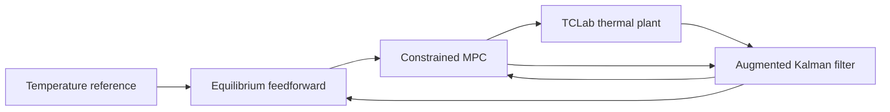

4# Model Predictive Control & State Estimation

**From system identification to experimental closed-loop control of a real thermal plant.**

Developed as a team project for Distributed Predictive Control and Estimation (ECPD), MSc in Electrical and Computer Engineering, Instituto Superior Técnico (2025/2026).
# Model Predictive Control & State Estimation

**From system identification to experimental closed-loop control of a real thermal plant.**

Developed as a team project for Distributed Predictive Control and Estimation (ECPD), MSc in Electrical and Computer Engineering, Instituto Superior Técnico (2025/2026).

## Overview

This project designs, simulates and experimentally evaluates a constrained model predictive controller (MPC) with augmented Kalman state and disturbance estimation for a Temperature Control Lab (TCLab) thermal system. It studies the trade-off between tracking accuracy, constraint violations, computational effort and smooth heater actuation under changing ambient conditions.

## Control architecture

The estimator reconstructs the state and an unknown input disturbance. The controller recomputes the reference equilibrium and solves a finite-horizon quadratic program at each sample, applying only the first optimized input.

## Methodology

| Stage | Engineering work |
| --- | --- |
| P1 | Constrained and unconstrained numerical optimization using the Rosenbrock function |
| P2 | Receding-horizon control and comparison with infinite-horizon LQ feedback |
| P3 | Experimental state-space identification and validation across three experiments |
| P4 | Dense and sparse MPC, actuator bounds, soft output constraints, reference tracking and Kalman filtering |
| P5 | Physical closed-loop experiments, disturbance tuning and comparison with PI control |

The team tested model orders 1–5. A second-order model was selected despite the third-order model having lower validation errors, because the latter showed a nonphysical inverse response in the controller.

## Experimental results

Final reported settings: 5 s sample time, 50 prediction steps (250 s), control weight R = 0.04, slack penalty alpha = 50 and disturbance covariance tuning delta_E = 0.1.

| Physical experiment | Normal tracking error (°C) | Constraint-active input std. dev. (% points) | Output violation (°C) |
| --- | ---: | ---: | ---: |
| MPC, delta_E = 1 (short run) | 0.11 | 10.09 | 0.96 |
| MPC, delta_E = 0.1 (short run) | 0.18 | 1.97 | 0.82 |
| MPC, delta_E = 0.1 + reference clamp | 0.18 | 0.56 | 0.00 |
| PI comparison | 0.33 | 5.76 | 2.43 |
| MPC, delta_E = 0.1 (long run) | 0.09 | 1.97 | 1.50 |

Source: team laboratory report, Table 2; metrics calculated over the last 40% of reference segments, excluding references at or below 30 °C. The clamped and selected long-run experiments had different ambient conditions. These are observed experimental results, not a formal safety guarantee.

Reducing disturbance covariance tuning from 1 to 0.1 reduced short-run constraint-active actuation variability by approximately 80.5%, with a modest tracking-error trade-off. The soft 55 °C output constraint can still be violated; reference clamping achieved zero measured violation in the reported run. Simulated MPC solve time averaged 29.82 ms, with a worst case of 545.02 ms.

### Example recorded experiment

*Existing experimental plot from the main branch; see the laboratory report for the configuration-specific comparisons above.*

## Repository layout

| Directory | Contents |
| --- | --- |
| [P1](P1) | Optimization exercises |
| [P2](P2) | Receding-horizon and LQ analysis |
| [P3](P3) | Thermal model identification and validation |
| [P4](P4) | MPC solvers, state estimation and simulations |
| [P5](P5) | Hardware experiments and recorded results |
| [TCLab_software_test](TCLab_software_test) | Hardware interface and initial tests |

The [final branch](https://github.com/luispma04/ECPD/tree/final) contains consolidated submission scripts, including `P4/P4_complete_sim.m` and `P5/closedloop.m`. The main branch retains supporting model data, figures and TCLab utilities.

## Getting started

Requirements: MATLAB, Control System Toolbox, Optimization Toolbox, and System Identification Toolbox for identification work. Physical experiments additionally require a compatible TCLab board and MATLAB interface.

Start with `P1/P1.m` and `P2/P2_solution.m`. Review the simulation scripts in P4 and the saved models in P3 and P4/P4_4 before running later stages. Some consolidated scripts reference model filenames and hardware utilities that are not present at the expected paths on the final branch; reconcile these dependencies with main before running. Check hardware connection and experimental limits before enabling closed-loop operation.

## Contributors

Team project (Group 5): Dinis Silva, Fernando Nóbrega, Fia Jakobsson, Luís Almeida and Tomás Serafim.

Instituto Superior Técnico · University of Lisbon · 2025/2026.

## Overview

This project designs, simulates and experimentally evaluates a constrained model predictive controller (MPC) with augmented Kalman state and disturbance estimation for a Temperature Control Lab (TCLab) thermal system. It studies the trade-off between tracking accuracy, constraint violations, computational effort and smooth heater actuation under changing ambient conditions.

## Control architecture

The estimator reconstructs the state and an unknown input disturbance. The controller recomputes the reference equilibrium and solves a finite-horizon quadratic program at each sample, applying only the first optimized input.

## Methodology

| Stage | Engineering work |
| --- | --- |
| P1 | Constrained and unconstrained numerical optimization using the Rosenbrock function |
| P2 | Receding-horizon control and comparison with infinite-horizon LQ feedback |
| P3 | Experimental state-space identification and validation across three experiments |
| P4 | Dense and sparse MPC, actuator bounds, soft output constraints, reference tracking and Kalman filtering |
| P5 | Physical closed-loop experiments, disturbance tuning and comparison with PI control |

The team tested model orders 1–5. A second-order model was selected despite the third-order model having lower validation errors, because the latter showed a nonphysical inverse response in the controller.

## Experimental results

Final reported settings: 5 s sample time, 50 prediction steps (250 s), control weight R = 0.04, slack penalty alpha = 50 and disturbance covariance tuning delta_E = 0.1.

| Physical experiment | Normal tracking error (°C) | Constraint-active input std. dev. (% points) | Output violation (°C) |
| --- | ---: | ---: | ---: |
| MPC, delta_E = 1 (short run) | 0.11 | 10.09 | 0.96 |
| MPC, delta_E = 0.1 (short run) | 0.18 | 1.97 | 0.82 |
| MPC, delta_E = 0.1 + reference clamp | 0.18 | 0.56 | 0.00 |
| PI comparison | 0.33 | 5.76 | 2.43 |
| MPC, delta_E = 0.1 (long run) | 0.09 | 1.97 | 1.50 |

Source: team laboratory report, Table 2; metrics calculated over the last 40% of reference segments, excluding references at or below 30 °C. The clamped and selected long-run experiments had different ambient conditions. These are observed experimental results, not a formal safety guarantee.

Reducing disturbance covariance tuning from 1 to 0.1 reduced short-run constraint-active actuation variability by approximately 80.5%, with a modest tracking-error trade-off. The soft 55 °C output constraint can still be violated; reference clamping achieved zero measured violation in the reported run. Simulated MPC solve time averaged 29.82 ms, with a worst case of 545.02 ms.

### Example recorded experiment

*Existing experimental plot from the main branch; see the laboratory report for the configuration-specific comparisons above.*

## Repository layout

| Directory | Contents |
| --- | --- |
| [P1](P1) | Optimization exercises |
| [P2](P2) | Receding-horizon and LQ analysis |
| [P3](P3) | Thermal model identification and validation |
| [P4](P4) | MPC solvers, state estimation and simulations |
| [P5](P5) | Hardware experiments and recorded results |
| [TCLab_software_test](TCLab_software_test) | Hardware interface and initial tests |

The [final branch](https://github.com/luispma04/ECPD/tree/final) contains consolidated submission scripts, including `P4/P4_complete_sim.m` and `P5/closedloop.m`. The main branch retains supporting model data, figures and TCLab utilities.

## Getting started

Requirements: MATLAB, Control System Toolbox, Optimization Toolbox, and System Identification Toolbox for identification work. Physical experiments additionally require a compatible TCLab board and MATLAB interface.

Start with `P1/P1.m` and `P2/P2_solution.m`. Review the simulation scripts in P4 and the saved models in P3 and P4/P4_4 before running later stages. Some consolidated scripts reference model filenames and hardware utilities that are not present at the expected paths on the final branch; reconcile these dependencies with main before running. Check hardware connection and experimental limits before enabling closed-loop operation.

## Contributors

Team project (Group 5): Dinis Silva, Fernando Nóbrega, Fia Jakobsson, Luís Almeida and Tomás Serafim.

Instituto Superior Técnico · University of Lisbon · 2025/2026.
